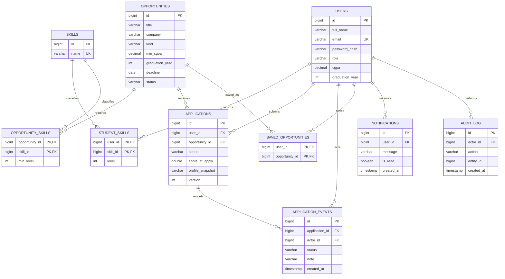

# Entity relationship diagram

`APPLICATIONS.user_id` references the applicant; Java limits this workflow to STUDENT. `APPLICATION_EVENTS.actor_id` identifies the student or office actor. Exact columns/constraints: [`../src/main/resources/schema.sql`](../src/main/resources/schema.sql).